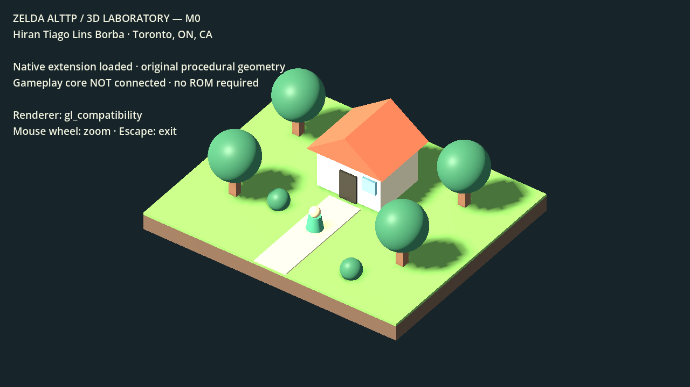

# Zelda A Link to the past — macOS & Windows

**A desktop adaptation project for The Legend of Zelda: A Link to the Past.**

[Source repository](https://github.com/htiagolborba/zelda-alttp-recomp) · [Releases](https://github.com/htiagolborba/zelda-alttp-recomp/releases) · [Builds](https://github.com/htiagolborba/zelda-alttp-recomp/actions)

Maintained by **Hiran Tiago Lins Borba** · Toronto, ON, Canada
[GitHub profile](https://github.com/htiagolborba)

This project builds on [snesrev/zelda3](https://github.com/snesrev/zelda3), a reverse-engineered C reimplementation of the SNES game. It adds platform build scripts, desktop packaging, a Triforce application icon, local asset preparation, release tooling, and project documentation.

The current version retains the original 2D presentation. A miniature diorama art direction inspired by Link’s Awakening for Nintendo Switch is a **planned research and development milestone**. No 3D remake or HD texture overhaul is included in this release.

## Latest development update — October 27, 2026

I have started the experimental 3D track with a native C extension and an original procedural scene in Godot 4.7.2. The first macOS lifecycle and renderer checks passed. This is a static infrastructure prototype; ALttP gameplay is not connected yet.

Read [the full M0 development update](docs/updates/2026-10-27-m0.md), follow [the changelog](CHANGELOG.md), or see [how project updates are maintained](docs/UPDATING-GITHUB.md).

## Project status

| Component | Status |
| --- | --- |
| macOS Intel build | Compiled locally with Apple Clang; application bundle prepared |
| Windows x86_64 build | Cross-compiled locally with LLVM-MinGW; native Windows gameplay testing pending |
| Gamepad input | Implemented upstream through SDL2; physical-device testing pending |
| Public GitHub releases | Automation prepared; publication pending repository setup and CI validation |
| Visual overhaul | Original graphics retained in the stable game; experimental static M0 laboratory implemented separately |
| 3D laboratory | macOS native lifecycle and Compatibility renderer verified locally; Windows/Forward+ checks pending |
| Apple Silicon native build | Not included in the current release targets |

Compilation and executable checks do not establish full gameplay compatibility. Audio, saves, room transitions, and physical controllers still need platform testing.

## Releases

The project prepares **two separate platform releases** for version `0.1.0`:

| Release tag | Download archive | Architecture |
| --- | --- | --- |
| `v0.1.0-macos` | `Zelda-ALttP-0.1.0-macos-x86_64.zip` | macOS Intel, 64-bit |
| `v0.1.0-windows` | `Zelda-ALttP-0.1.0-windows-x86_64.zip` | Windows, 64-bit |

Each archive has a companion `.sha256` checksum file and an internal file manifest. After publication, downloads will be available from this repository’s **Releases** tab. Until then, no public download is advertised.

Release packages contain the executable, configuration, credits, licenses, and local extraction tools. **They do not include a ROM or extracted game assets.** You must supply your own compatible ROM and prepare the assets on your computer.

The macOS application is not Developer ID signed or notarized. The Windows executable is not Authenticode signed. Release targets are not a guarantee of compatibility with every operating-system version or driver.

## Getting started

### 1. Prepare your game assets

Use an unmodified USA revision 0 ROM, without a copier header:

- Size: **1,048,576 bytes** (1 MiB)
- SHA-256: `66871d66be19ad2c34c927d6b14cd8eb6fc3181965b6e517cb361f7316009cfb`

Install Python 3.10 or later from [python.org](https://www.python.org/downloads/) if needed. Extract the release archive before running any commands. Run the following commands from the extracted package folder.

**macOS:**

```sh
python3 -m venv .venv
.venv/bin/python -m pip install -r tools/requirements.txt
.venv/bin/python tools/prepare-assets.py "/path/to/your/zelda3.sfc" \
  --output "$HOME/Library/Application Support/Zelda ALttP/zelda3_assets.dat"
```

**Windows — PowerShell:**

```powershell
py -3 -m venv .venv
.\.venv\Scripts\python.exe -m pip install -r tools\requirements.txt
.\.venv\Scripts\python.exe tools\prepare-assets.py "C:\path\to\your\zelda3.sfc" `
  --output "$env:LOCALAPPDATA\Zelda ALttP\zelda3_assets.dat"
```

Extraction validates the ROM hash and works in a temporary directory. The ROM remains on your computer; the tool does not upload it. Python is needed for extraction, not for normal gameplay.

### 2. Launch the game

- **macOS:** open `Zelda ALttP.app` after asset preparation.
- **Windows:** run `Launch-Windows.cmd`. Keep `SDL2.dll` beside `zelda3.exe`.

Use the supplied launchers so configuration, assets, and saves are resolved from the correct location. Double-clicking the Windows executable directly does not use the launcher’s data-directory setup.

| Platform | User data directory |
| --- | --- |
| macOS | `~/Library/Application Support/Zelda ALttP/` |
| Windows | `%LOCALAPPDATA%\Zelda ALttP\` |

The first launch copies the default `zelda3.ini` into that directory. Edit that copy to customize controls, audio, graphics, and window settings. Save data is also stored below the user data directory; back it up before replacing a release.

## Controls

### Keyboard

| Action / SNES button | Default key |
| --- | --- |
| Move | Arrow keys |
| Start | Enter |
| Select | Right Shift |
| A | X |
| B | Z |
| X | S |
| Y | A |
| L / R | C / V |
| Toggle fullscreen | Alt + Enter |
| Load snapshot | F1–F10 |
| Save snapshot | Shift + F1–F10 |

Some macOS keyboards require the Fn key to send function keys.

### Gamepads, including Xbox controllers

The SDL2 controller backend accepts compatible controllers recognized by the operating system over **Bluetooth or USB**. This includes Xbox controllers when supported by the OS, controller model, firmware, and SDL2 mapping. D-pad movement, left-stick movement, shoulder buttons, and controller connection events are implemented in the source.

| Xbox-style input | SNES input |
| --- | --- |
| D-pad / left stick | Movement |
| Menu / Start | Start |
| View / Back | Select |
| B | A |
| A | B |
| Y | X |
| X | Y |
| LB / RB | L / R |

The face buttons preserve the SNES physical layout rather than matching the printed Xbox button letters. Customize the mapping in `[GamepadMap]` in your `zelda3.ini`:

```ini
[GamepadMap]
Controls = DpadUp, DpadDown, DpadLeft, DpadRight, Back, Start, B, A, Y, X, Lb, Rb
```

Pair the controller in your operating system first, then launch the game. If input is missing, verify the controller works in the OS and try reconnecting it or restarting the game. Physical Bluetooth and USB controller tests have not yet been completed for these packages.

## Building from source

### macOS Intel

Install Apple’s Command Line Tools with `xcode-select --install`. You also need SDL2 development files and Python with Pillow/PyYAML for asset preparation. `build-macos.sh` automatically uses `.tools/sdl2/` when available, or `sdl2-config` from your `PATH`.

```sh
python3 -m venv .venv
.venv/bin/python -m pip install -r requirements-build.txt
.venv/bin/python scripts/prepare-assets.py "/path/to/your/zelda3.sfc" \
  --output zelda3/zelda3_assets.dat
./build-macos.sh
```

The executable is `zelda3/zelda3`. The release packager intentionally excludes the assets you generated locally.

### Windows x86_64

The cross-build script runs in a Bash environment with a MinGW-w64 compiler, resource compiler, and the **Windows x86_64 SDL2 development package**. It does not use the macOS SDL2 library.

```sh
export SDL2_WINDOWS_PREFIX="/path/to/SDL2-2.32.10/x86_64-w64-mingw32"
export WINDOWS_CC="x86_64-w64-mingw32-gcc"
export WINDOWS_WINDRES="x86_64-w64-mingw32-windres"
bash scripts/build-windows.sh
```

For cross-compilation on macOS, point `WINDOWS_CC` and `WINDOWS_WINDRES` to the matching [LLVM-MinGW](https://github.com/mstorsjo/llvm-mingw) tools. Outputs are written to `build/windows/`. Assets are not required to compile the executable.

### Package either platform

```sh
python3 scripts/package-release.py macos --version 0.1.0 \
  --sdl-license /path/to/SDL2/LICENSE.txt
python3 scripts/package-release.py windows --version 0.1.0 \
  --sdl-license /path/to/SDL2/LICENSE.txt
```

The packager copies an explicit set of files into a fresh staging directory and produces ZIP archives and checksums under `dist/`. It refuses to reuse a staging directory. The macOS packager requires Pillow to convert the upstream icon to ICNS.

## GitHub release workflow

[`.github/workflows/releases.yml`](.github/workflows/releases.yml) builds the macOS Intel package and cross-builds the Windows package. A separate Windows runner checks that the Windows executable loads and reports its version without requiring a ROM.

1. Publish the source repository, excluding local ROMs, extracted assets, and build directories.
2. Open **Actions → Platform releases → Run workflow**.
3. Enter the version, such as `0.1.0`. Leave **Create draft releases** disabled for a build-only run.
4. Review the resulting artifacts and complete the manual platform checks in [the release checklist](docs/RELEASING.md).
5. Run the workflow with **Create draft releases** enabled to prepare `v0.1.0-macos` and `v0.1.0-windows`.
6. Review the draft release notes and publish each platform release when ready.

The stable platform build and Windows executable-loader workflow passed in GitHub Actions during the initial desktop adaptation. Draft creation requires repository write access. Build-related pushes to `main` start that pipeline; existing versioned releases are preserved. The separate experimental 3D workflow still needs its own remote validation. No ROM secret or ROM upload is needed in CI.

## Experimental 3D laboratory (M0)



*Actual engine capture. Static technical prototype with a stationary marker; no ALttP gameplay or ROM resources are connected.*

A ROM-free Godot 4.7.2 laboratory now verifies native-library loading and displays an original procedural scene. The macOS lifecycle and Compatibility renderer have been tested locally. Windows native loading and Forward+ rendering still require validation. The ALttP gameplay core is not connected yet.

See [setup and commands](docs/3d/GETTING-STARTED.md), [verified M0 results](docs/3d/M0-RESULTS.md), and the [actual viewport capture](docs/3d/images/m0-laboratory.png). This experimental project is separate from the stable 2D game releases.

## Visual development roadmap

The proposed architecture, visual requirements, hardware profiles and milestone gates are documented in the [3D blueprint](docs/3d/BLUEPRINT.md), [architecture](docs/3d/ARCHITECTURE.md), [decisions](docs/3d/DECISIONS.md), and [implementation plan](docs/3d/IMPLEMENTATION-PLAN.md). These are draft specifications; they do not represent an implemented 3D engine.

The long-term goal is to explore a handcrafted miniature aesthetic: rounded forms, stylized materials, soft lighting, and a diorama camera, while retaining the original gameplay logic.

The next milestone is a **small playable visual prototype**, not an immediate replacement of all game graphics:

1. Establish the original renderer as a gameplay reference.
2. Prototype one outdoor area with original 3D assets and an inclined camera.
3. Connect the scene to the C game state and verify spatial alignment and collisions.
4. Add one interior, animation, interactions, and transitions.
5. Evaluate performance and the asset-authoring workflow before expanding.

Shaders or upscaled textures alone cannot provide that result. Renderer integration and new models, materials, and animation are substantial work still ahead.

## Credits and licensing

**Project lead:** Hiran Tiago Lins Borba · Toronto, ON, Canada
**Profile:** [github.com/htiagolborba](https://github.com/htiagolborba)

Platform adaptation, packaging, release tooling, and documentation are developed with assistance from OpenAI Codex. See [CREDITS.md](CREDITS.md) for the contribution scope and third-party acknowledgements.

- **Game reimplementation:** [snesrev/zelda3](https://github.com/snesrev/zelda3), with credits to snesrev and elzo_d. The upstream [license and notices](zelda3/LICENSE.txt) are preserved.
- **SDL2:** [Simple DirectMedia Layer](https://www.libsdl.org/), under the zlib license.
- **Opus:** bundled upstream decoder, with its original license and notices.
- **Original game, characters, artwork, and related marks:** Nintendo.

Original contributions to this adaptation are licensed under [MIT](LICENSE). This license does not grant rights to Nintendo game assets or replace the licenses of third-party components. This is an independent fan project and is not affiliated with or endorsed by Nintendo.
