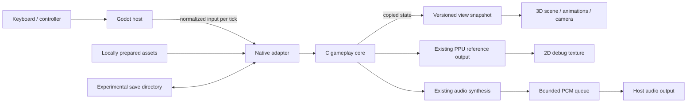

# Proposed architecture and bridge contract

Status: target design. An initial implementation now exists; see [the actual M1 contract](CORE-INTEGRATION.md) and [verified results](M1-RESULTS.md). Queue-based audio, full semantic events and persistent experimental saves remain planned. Owner: Hiran Tiago Lins Borba.

## Runtime boundary



The diagram shows responsibilities, not independent simulation threads. Start
with single-thread ownership of the core, stepping and audio synthesis. Only
copied snapshots and PCM cross ownership boundaries. Investigate threading
later if profiling proves a need.

## Audit findings in the current source

- `main.c` owns window/input/event handling, SDL audio setup and synchronization,
  initialization order, asset loading, frame pacing, and rendering selection.
- `ZeldaInitialize`, `ZeldaRunFrame`, and `ZeldaDrawPpuFrame` exist in the runtime
  interface, but they are not a complete embeddable lifecycle.
- `LoadAssets` is static inside `main.c`; initialization must be extracted with
  its dependencies, rather than linking a second `main` into Godot.
- State resides in globals (`g_ram`, `g_zenv`, configuration, audio/replay state).
  The first bridge supports **one instance per process**, not multiple worlds.
- The host uses 17/17/16 ms pacing for approximately 60 updates/s. The new host
  must schedule simulation explicitly; render frequency is independent.
- `ZeldaRunFrame` observes music state (`ZeldaIsMusicPlaying`/APUI00). Therefore
  audio processing cannot be discarded when testing gameplay determinism.
- The runtime still uses PPU/APU/DMA state. Replacing visible output does not
  establish that these components can be removed from the simulation.
- `variables.h` exposes player coordinates, area/room IDs and sprite arrays,
  but does not provide a semantic 3D scene graph or a universal height map.
- SRAM writes use relative paths under `saves/`. Host separation must introduce
  a deliberate file-access policy; do not change process cwd inside an extension.

## Proposed native API responsibilities

Use a small C ABI, wrapped by a thin C++ GDExtension class. This list is a design
contract; names and layouts must be finalized during M1.

| Operation | Contract |
| --- | --- |
| `core_initialize(config)` | Validate local asset path, data directory, options and ABI; initialize one core instance; return structured errors |
| `core_step(input)` | Advance exactly one tick; normalize host buttons into the audited core input representation |
| `core_copy_snapshot(buffer)` | Copy the latest completed state; include ABI version, byte size, tick and scene generation |
| `core_read_events(cursor)` | Return bounded semantic events with monotonically increasing sequence IDs and overflow status |
| `core_render_reference(buffer)` | Produce debug pixels at defined safe phase; must not advance simulation a second time |
| `core_produce_audio(frames)` | Advance the audited audio schedule under core ownership and publish PCM |
| `core_save / core_load` | Validate save namespace/version; define synchronization boundary; rebuild view state after load |
| `core_shutdown()` | Stop consumers, persist permitted data, release owned allocations; no dangling callbacks |

Use fixed-width fields and explicit packing/marshalling rules. Include
`abi_version` and `struct_size`; do not expose raw pointers to internal structs
or rely on C++ containers across a binary boundary. The Godot wrapper translates
native data to view objects. Final definitions require a buildable interface
spike and platform tests, not only this document.

## Snapshot content

Minimum envelope: tick ID, scene generation, world/area/room IDs, game module,
submodule, pause/transition flags, camera reference values and active layer.

Player view: source X/Y, jump Z, validated floor/plane information, direction,
action/animation phase, visibility, damage state and HUD values needed by the slice.

Entity view: slot, spawn generation, semantic type, source position, height/plane,
action phase and visibility. A reused sprite slot is not the same entity. Scene
reset/load invalidates all old entity identities.

Scene delta: doors, bushes, pickups, destroyed props and other changes relevant
to the slice. Some require instrumentation in the core, rather than inference
from a changed pixel or repeated snapshot. Events carry sequence IDs; a missed
event triggers a full view resynchronization instead of permanent divergence.

## Coordinates and interpolation

Initial mapping proposal: `world_x = (source_x - scene_origin_x) / 16`,
`world_z = (source_y - scene_origin_y) / 16`, with vertical Y derived from the
authored floor plus a separately calibrated jump displacement. Confirm whether
raw Z is signed, fixed-point, or uses sentinel values for each relevant state.

Convert different exported map units explicitly. Do not apply the pixel divisor
to fields that already represent tiles or object-grid coordinates. Store each
converter's source unit and origin in its schema.

Apply interpolation only between compatible snapshots of the same entity/scene.
Snap after teleport, load, scene change, respawn or discontinuity. Render 30/60+
fps without advancing core time extra to chase a display refresh rate. If the
host falls behind, use bounded catch-up, report the overrun, and avoid silent
loss of simulation ticks. Pause may freeze the simulation; define audio/UI
behavior independently and test it.

## Input and gameplay authority

Godot owns device discovery and remapping in the new host. The adapter owns the
translation to core bits. Do not assume the existing SDL key command order is
identical to the low/high SNES joypad enum. Verify the mapping with fixtures.

No duplicated movement controller, Rigidbody movement, Godot navmesh AI, or
animation-driven damage in the slice. Visual collision proxies may be generated
for diagnostics, but the original collision result governs behavior. A future
change to gameplay rules would require a separate specification.

## Audio, save and reference behavior

Retain the current synthesis initially. Specify sample rate/channel negotiation,
buffer duration, underrun/overflow reporting and the APU schedule. A native PCM
queue can feed Godot audio. Avoid per-sample GDScript loops. Audio callback threads
must not invoke unsynchronized core mutation or Godot scene operations.

Reference mode is a diagnostic window/panel fed by the same state, with a defined
render phase. If reference drawing mutates state, preserve its necessary work
regardless of whether its pixels are shown. Benchmark and audit this before
claiming a render-free/headless core.

Use a new namespace such as `Zelda ALttP 3D Preview` in the OS application-data
folder. Copy SRAM explicitly for import. Check snapshot compatibility separately
from SRAM: do not promise old replay/snapshot portability after refactoring.

## Scene/content pipeline

1. Extract source data locally from the validated ROM.
2. Inspect the selected area's schema and confirm identifiers and units.
3. Generate a local intermediate semantic map with validation diagnostics.
4. Combine with authored geometry, semantic replacements, height overrides,
   camera bounds, cutaway rules and spawn anchors.
5. Export models/animation from Blender as glTF 2.0/GLB and import into Godot.
6. Validate the result against source collision and reference rendering.

A tile's graphics index is not a universal object identity. Repeated graphics can
represent different gameplay objects. Maintain mappings scoped by scene and
state. Derived maps remain local; authored original models/materials may be
versioned with provenance. No automatic conversion to finished 3D is assumed.

## Proposed source layout

```text
native/core_host/       extracted host services and C ABI
native/godot_bridge/    thin C++ GDExtension wrapper
presentation/godot/    Godot project, view scripts, scenes and UI
art/source/            authored modeling sources, subject to size policy
art/export/            original GLB assets and provenance
scripts/world_tools/   local source-data converters and validators
local-data/            ignored ROM-derived intermediate maps and fixtures
```

These directories are proposed; creating this document does not create a
runtime. Add ignore and packaging rules before placing derived content there.

## Validation strategy

- Compare the existing host and extracted host using a reproducible initial
  state, input log, feature configuration, audio schedule and fixed tick count.
- Audit which RAM/state fields are meaningful comparison targets; do not simply
  exclude differing values to make a test pass.
- Test at least idle/movement, attack, entity slot reuse, damage, a dynamic prop,
  a doorway transition and save/load. Keep ROM-derived fixtures local.
- Compare playback at different render rates with the same simulation inputs.
- Run reference and snapshot debug overlays while tuning camera and geometry.
- Test the built native library on each OS; compiling for Windows alone does
  not validate loading it into the chosen Godot version.
