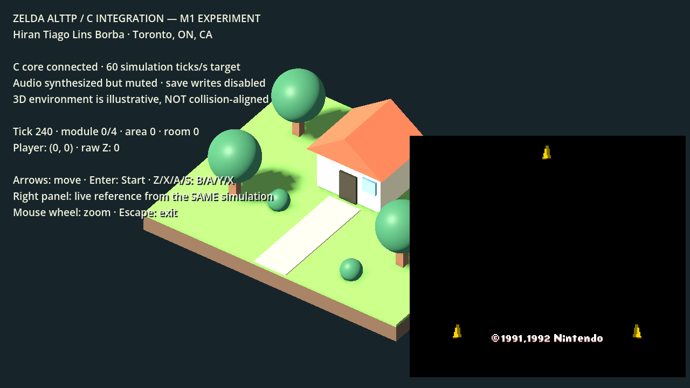

# M1 — experimental C gameplay integration

Project lead: **Hiran Tiago Lins Borba**. Implemented with OpenAI Codex assistance.

The Godot laboratory can now initialize and step the existing snesrev/zelda3
C gameplay implementation. This is an initial integration, not a finished 3D
playable world. The original SDL executable remains a separate reference host.



The right-hand panel contains pixels from the same C simulation. In this capture
the game is in its intro, so the player marker is hidden. The 3D house and terrain
are still an illustrative blockout, not converted ALttP map geometry.

## Build and run on macOS Intel

First complete [Godot setup](GETTING-STARTED.md). From the repository root:

```sh
python3 scripts/build-godot-probe.py
python3 scripts/build-core-host.py --godot
python3 scripts/run-core-lab.py --assets "/absolute/path/zelda3_assets.dat"
```

To import existing progress, explicitly supply an 8 KiB SRAM file:

```sh
python3 scripts/run-core-lab.py --assets "/absolute/path/zelda3_assets.dat" \
  --sram "$HOME/Library/Application Support/Zelda ALttP/saves/sram.dat"
```

SRAM is read into a separate in-memory session. The original file is never
written. In-game save requests are counted but disk writes are disabled in this
host. Do not use this preview for a playthrough whose progress you need to keep.

The frontend checks the canonical USA resource bundle hash:
`0fe2e4bd75d70f06fb9a74cd3a9cb336c838149b831b56e8792114a89292c793`.
Use [the existing local extractor](../../scripts/prepare-assets.py) to generate it
from your own compatible ROM. No ROM-derived bundle or SRAM is included in Git.
The C loader validates the asset signature, counts, offsets and lengths; it is
not a general-purpose sandbox for modified/malicious game data.

## Windows development

The Windows bridge has been cross-compiled locally; native execution is pending.
Use an x64 Visual Studio developer prompt with the LLVM/Clang C compiler and
Windows SDK available, then run:

```bat
python scripts\build-godot-probe.py
python scripts\build-core-host.py --target windows --cc clang --godot
python scripts\run-core-lab.py --assets "C:\absolute\path\zelda3_assets.dat"
```

For the RTX development PC, evaluate `--renderer forward_plus` after the
Compatibility baseline works. This is a test option, not a verified support claim.
LLVM-MinGW can also cross-compile the bridge with `--target windows --cc <path>`.
No SDL development library is needed to build the new core host.

To compare Godot with a standalone Windows DLL after native setup, also build with `python scripts/build-core-host.py --target windows --cc clang` (without `--godot`) and run `scripts/test-godot-core.py` with the local engine and assets paths. This Windows check has not been executed locally.

## Input and visualization

The new host targets 60 physics/simulation ticks per second. Godot supplies input;
it does not compute a separate movement or collision result.

| Input | Core action |
| --- | --- |
| Arrow keys / left stick / D-pad | Direction |
| Enter / controller Start | Start |
| Shift / controller Back | Select |
| Z / Xbox A | SNES B |
| X / Xbox B | SNES A |
| A / Xbox X | SNES Y |
| S / Xbox Y | SNES X |
| C / V, LB / RB | L / R |
| Mouse wheel / Escape | View zoom / exit laboratory |

Keyboard mapping is physical-key based. Controller code is implemented but
physical controller validation remains pending. The first connected pad is used.

The native input mask matches the upstream SDL host: B=1, Y=2, Select=4, Start=8,
Up=16, Down=32, Left=64, Right=128, A=256, X=512, L=1024, R=2048. This differs from
both the SNES register layout and a sequential UP/DOWN-first mapping.

A geometric marker follows copied X/Y coordinates only when the core reports
normal indoor/outdoor gameplay modules. Its origin is rebased on scene changes.
Jump Z is shown as raw diagnostic data; no floor height or jump interpretation
is inferred yet. The 3D environment is not collision-aligned and should not be
used to judge whether the actual player can pass an obstacle.

The reference image updates at 10 Hz to limit the overhead of the temporary
hex/String transport. The C simulation and PPU work still run every tick. This
transport is diagnostic and will be replaced by a direct texture/buffer bridge
before performance certification.

## Runtime contract

- One core session per process, one owning simulation thread. Restart the process
  to reopen after shutdown. No multi-instance or concurrent API support is claimed.
- `AlttpCoreBridge`, a small Godot Object class, exposes a vararg `request` method:
  `open`, `step`, `snapshot`, `frame`, `close`. JSON strings carry copied state or
  structured errors; the frame operation returns RGBA hex data.
- The standalone C ABI additionally exposes a version/size-checked snapshot struct.
- Snapshots contain tick, scene generation, module, submodule, player coordinates,
  raw Z, facing, indoor/area/room IDs, joypad state, health and save-request count.
- No raw pointer to mutable game state is exposed to GDScript.
- The PPU still runs, because drawing also performs HDMA/PPU work. Its width is
  explicitly configured to 256 pixels, matching the reference buffer.
- Audio synthesis runs once per tick: 534 stereo frames at the 32000 Hz source
  rate. Output is discarded; APU feedback remains available to gameplay.
- This controlled offline schedule is not a claim of bit-exact live SDL-device
  callback timing, original-console equivalence or cross-platform determinism.
- Host file access uses explicit paths. It does not change process cwd or create
  save files. Fatal errors routed through upstream `Die` are trapped at the C
  boundary; legacy assertions/unsupported resource contents are not all recoverable.

The original code receives only narrowly scoped compile-time changes: the new
host can include configuration data without SDL key types, release its recorder
buffers, and suppress SRAM disk writes. These paths are disabled in stable builds.

## Tests

No-ROM CI checks compile the bridge, instantiate its Godot class and verify
structured failures for absent resources, unopened sessions and invalid types.
Real gameplay parity tests remain local because they require user-owned data.

```sh
python3 scripts/build-core-host.py
python3 scripts/build-core-reference.py --sdl-config /path/to/sdl2-config
python3 scripts/test-core-host.py --assets /path/to/zelda3_assets.dat \
  --reference build/core-host/reference-runner
python3 scripts/test-core-host.py --assets /path/to/zelda3_assets.dat \
  --sram /path/to/sram.dat --reference build/core-host/reference-runner
python3 scripts/test-godot-core.py \
  --godot .tools/godot-4.7.2/Godot.app/Contents/MacOS/Godot \
  --assets /path/to/zelda3_assets.dat
python3 scripts/test-core-address-safety.py --assets /path/to/zelda3_assets.dat
```

The reference harness compiles the original SDL host loader/helpers with its
entry point renamed. Both hosts receive the same explicit options, input stream,
PPU configuration and offline audio schedule. Comparison covers every tick's
RAM, SRAM, VRAM, SPC RAM, framebuffer and PCM using a non-cryptographic FNV-1a
checksum. It is a regression check, not a complete proof of state equivalence.
The legacy-host reference and sanitizer scripts currently target macOS Intel. The standalone/Godot comparison can also load a Windows DLL but still requires native Windows validation.

## Remaining work

Validate native Windows execution and actual controller input; broaden fixtures
for combat and transitions; implement a bounded PCM output queue and independent
experimental save namespace; replace diagnostic frame transport; map source
areas/rooms, heights, dynamic objects and collision footprints into a graybox.
Only then expand toward a playable 3D slice and final art.
