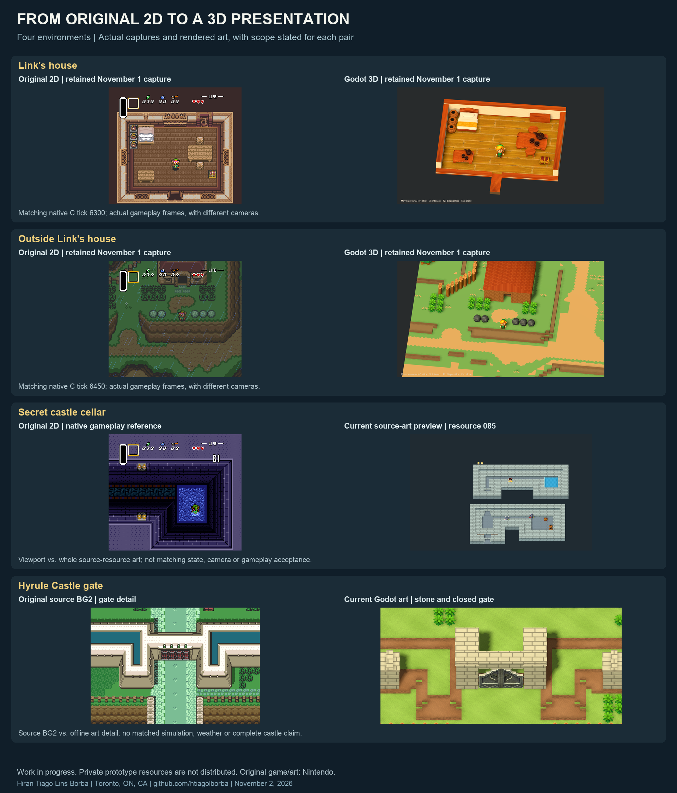
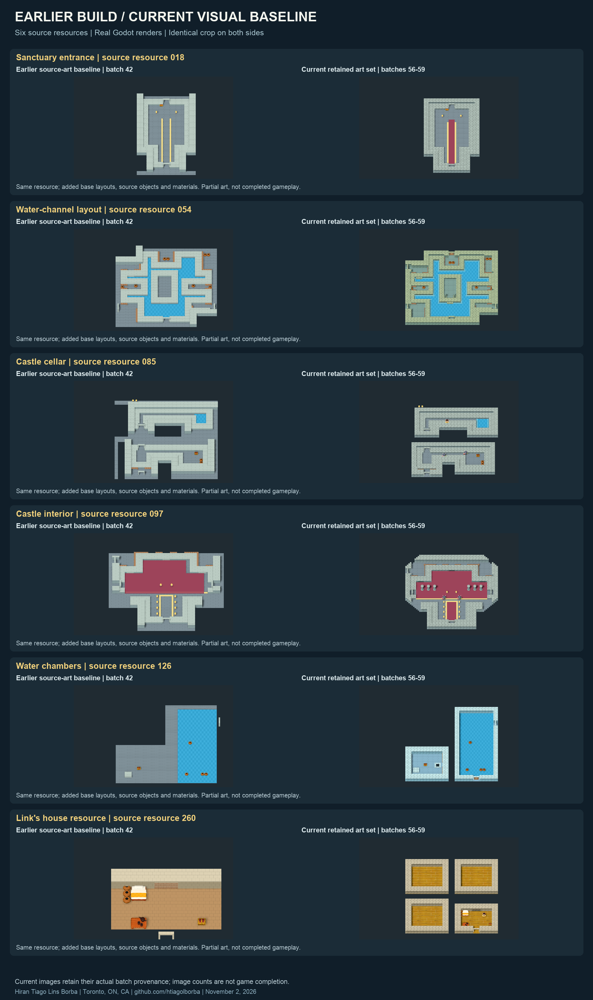
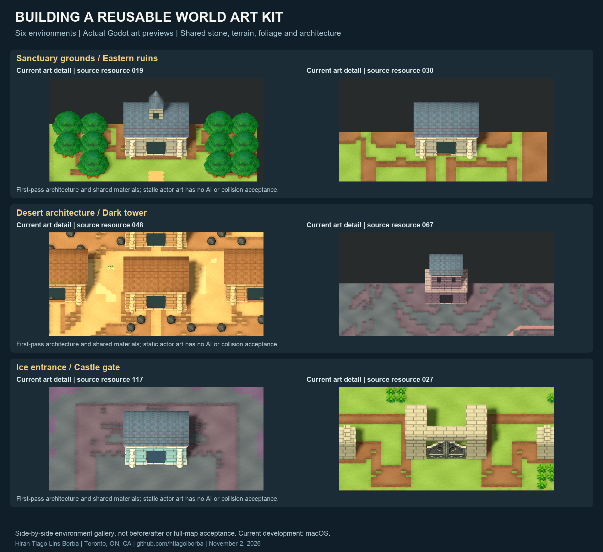

# From a playable room to a reusable 3D world pipeline

> Publication guide: paste the title and body below into a GitHub Discussion in an Announcements category, if Discussions is enabled. This is a development update, not release notes for a new binary. Publish after pushing the documentation commit. Relative image links in repository Markdown work directly; for a Discussion, upload the five PNGs from `docs/images/2026-11-02/` and insert the uploaded images at the indicated positions.

## Title

Visual development update: expanding ALttP into a source-driven 3D world

## Body

I have taken the next step in my *A Link to the Past* visual reconstruction project: moving from a small set of individually developed scenes toward a reusable production pipeline for interiors and outdoor environments.

I am leading this work as **Hiran Tiago Lins Borba**, based in Toronto, ON, Canada. My goal is to preserve the original game's behavior while building a miniature 3D presentation around the existing reverse-engineered C simulation.

### See the difference

Four environments show the direction: Link's house, its exterior, the secret castle cellar and the castle gate. The house pairs retain the previous matching-state gameplay captures. The cellar and gate are current art previews beside original references, with different cameras and state scope explicitly labeled.

The indoor comparison shows how much source structure and reusable art matter: base layouts, wall contours, flooring, carpets, water trim, columns and furniture now reach multiple environments through the same pipeline.

The outdoor gallery brings together sanctuary, eastern ruins, desert architecture, dark tower, ice entrance and castle gate. These are actual Godot art renders, not concept images. Architecture is still a first pass.

### What I have built in this phase

- A 320-resource indoor art baseline, including unused/default-only source resources.
- Eight native base-layout templates and 19,972 supported source-object descriptors, including repeated layout objects.
- Shared wood and stone materials, provisional regional themes, 508 static portal archetypes and 715 water/pit edge descriptors.
- Static actor art for 286 indoor source placements, plus 147 supported first-part exterior placements.
- Shared terrain and architecture across 80 normal exterior baselines, with two separately scoped special-area previews.
- Batch render tooling and traceable image reuse to spend more development effort on content rather than repeated manual traversal.

These are **production coverage figures**, not counts of completed rooms or playable maps. Enemy art does not establish AI or combat integration, and a source-derived scene does not yet reproduce every story state or graphics layer.

### Engineering approach

I use **C** for the existing simulation, **Godot/GDScript** for 3D presentation, **Python** for source processing and production tooling, and shaders/materials for surface treatment. The project does not use Nintendo's Switch engine.

I keep original-renderer references, document failed attempts, and separate static art review from native gameplay acceptance. Current development focuses on **macOS**; Windows prototype work is deferred.

### What comes next

I will continue the visual-content and architecture pass, address remaining source layers and special graphics, then integrate the expanded presentation with native actor/state rules and validate longer connected gameplay routes.

This checkpoint updates screenshots and documentation. **Stable public downloads are still 2D; there is no new 3D release in this update.** Private models, textures and game data are not included.

I lead the adaptation and integration with AI-assisted development. Credit for the upstream reverse-engineered game implementation remains with **snesrev/zelda3** and its contributors; original game content and artwork belong to **Nintendo**.

Full report: https://github.com/htiagolborba/zelda-alttp-recomp/blob/main/docs/updates/2026-11-02-visual-production.md

Project: https://github.com/htiagolborba/zelda-alttp-recomp
