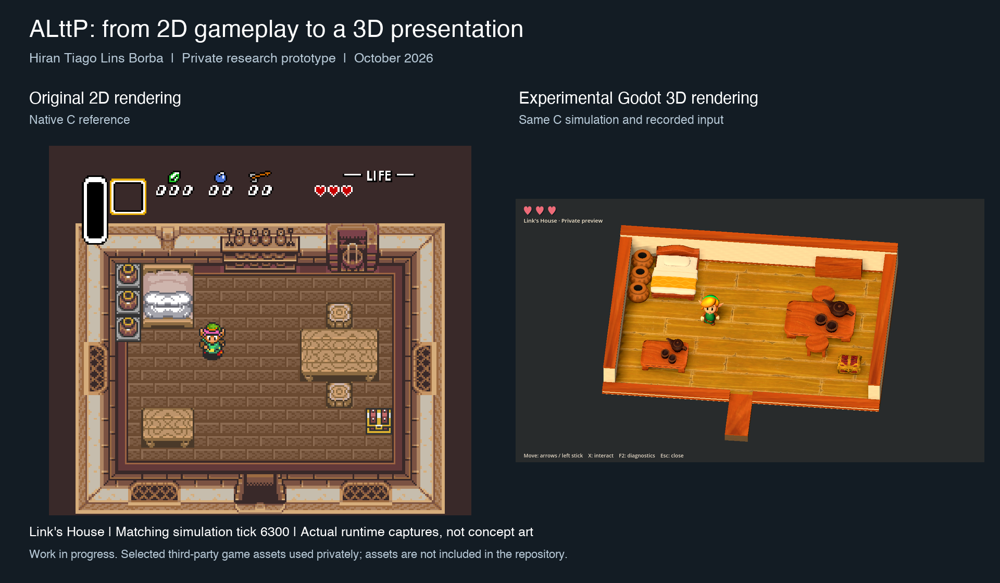

# Opening-room 3D presentation milestone

**October 28, 2026 · Hiran Tiago Lins Borba · Toronto, ON, Canada**

The private prototype now renders an animated Link inside a reconstructed 3D version of the opening house. Godot presents the scene while the existing native C implementation remains authoritative for movement, collisions and game state.

Both sides are actual runtime captures at recorded simulation tick 6300. This static comparison illustrates the visual result; it does not itself demonstrate animation or benchmark performance.

## What I implemented

I integrated the C host with Godot, mapped source coordinates and facing to the 3D scene, connected idle/walk animation to actual C movement, and added bounded foot-placement corrections. I reconstructed the opening room using ALttP collision footprints, fitted selected private props, and refined materials, lighting, camera and cutaway walls.

The implementation uses C, GDScript and Python. It builds on the reverse-engineered C implementation from [snesrev/zelda3](https://github.com/snesrev/zelda3); the upstream team's reverse engineering is not my original work. Character and selected art assets belong to Nintendo. My contribution is the adaptation, integration, presentation pipeline and validation work described here.

## Verified scope

- First styled room tested locally on macOS with Godot 4.7.2, Compatibility renderer.
- Recorded room route: 331 native state and actor samples retained parity with the accepted reference.
- Separate wall and exit routes checked 151 and 841 samples respectively.
- Ten prop/door footprints fit the original source rectangles within the frozen one-source-pixel budget; independent reconstruction measured a maximum error of approximately 0.00000418 pixels.
- Existing animation and foot-placement criteria continued to pass. Shadow artifacts and clipped controls were repaired and captured again.

These checks concern a bounded route and one room. Unsupported outdoor geometry is hidden after exiting; the exit test does not establish a completed outdoor scene. Materials approximate opaque PBR, and some heights and trim are artistic choices. Diagnostic capture pauses are not performance measurements.

## Work in progress

P0–P4 are accepted within their documented local scope. P5 is in progress: native read-only inventory, PCM, SRAM and outdoor-grid diagnostics are being tested before adding C-driven interactions, dialogue, combat, a second space and isolated save/audio behavior. Windows runtime, physical controller testing, platform performance and final private packaging remain pending.

The stable public application retains the original 2D renderer. This update is not a new playable public 3D release, a complete remake, or a port of Nintendo's Switch engine.

## Repository boundary

This update contains documentation and a runtime comparison image. ROMs, dumps, keys, converted models, textures, private saves and private evidence are not included. The screenshot does not grant rights to the original game art. No public 3D asset package or release is provided.
