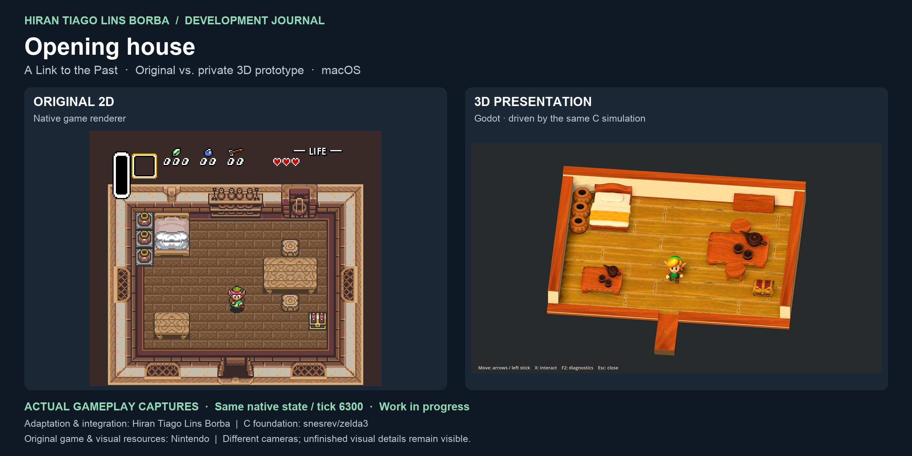
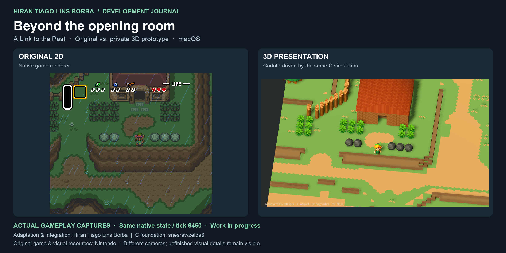
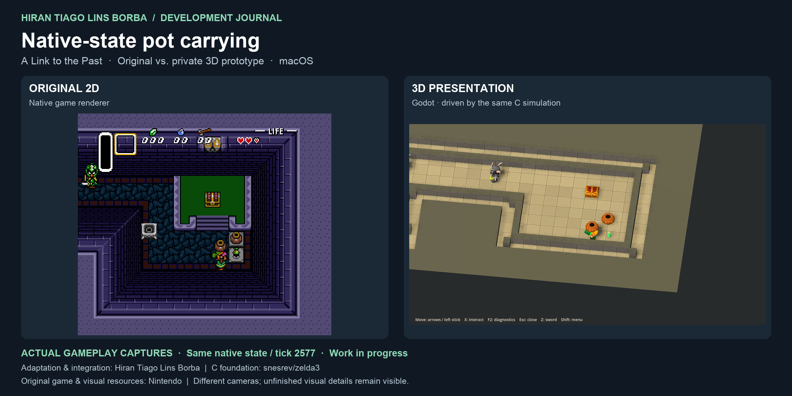

# Native 3D progress — November 1, 2026

By **Hiran Tiago Lins Borba** · Toronto, ON, Canada · [GitHub](https://github.com/htiagolborba)

I am developing a miniature 3D presentation for *A Link to the Past* on macOS, using Godot with the existing reverse-engineered C gameplay implementation from [snesrev/zelda3](https://github.com/snesrev/zelda3). This checkpoint expands the opening-room experiment into connected outdoor presentation and tested interactions. It is an ongoing private prototype, not a finished remake or a new downloadable 3D release.

## Actual gameplay comparisons

Each pair below was captured from a running macOS session. The left image is the original 2D renderer; the right image is the Godot viewport. Both use the **same native C state and tick**. These are captured game frames, not concept art or generated mockups. The cameras and framing differ. Debug labels are hidden in the 3D captures; the original HUD remains visible.

### Opening house

### Outside the house

### Carrying a pot

The pictures demonstrate these particular states, not complete coverage of every map or interaction. Original game content and privately converted visual resources remain credited to Nintendo. Screenshots are documentation; the underlying models, textures and game data are not distributed here.

## What changed since the October 28 checkpoint

| Workstream | Implemented privately | Current limit |
| --- | --- | --- |
| Connected presentation | Source-driven terrain, paths, foliage, water, shoreline detail, fences and house presentation across selected outdoor contexts | Full-world coverage and visual acceptance remain unfinished |
| Indoor presentation | Specialized house/cellar scenes plus a source-grid fallback and reusable furniture descriptors | A descriptor or fallback does not mean a room has been fully rebuilt |
| Link and props | Animated character, native-state pot carrying, thrown-pot lifetime and source-gated furniture removal | Some lift/throw animation phases and destruction effects remain provisional |
| Pickups | Ten presentation types supported by the loader; gallery checks and selected live pickups | Gallery coverage is not proof that all ten types were collected in gameplay |
| Audio | Native synthesized PCM delivered to Godot, with loading/capture guards | Tested routes only; broad latency and device testing pending |
| Menus and recovery | Native menu framebuffer fallback; actual Game Over, continue without saving and restored movement tested | These are interim original-style menus, not a finished 3D UI |
| Save isolation | Read-only baseline import and separate exports on native save requests | Normal saves remain isolated; broader save-slot testing pending |
| Production tools | Source-derived map decoding, settlement profiles, repeatable short regressions and bounded interactive diagnostic history | Offline map previews are distinct from live gameplay |

The offline map compiler decoded **80 normal overworld region resources**. This is pipeline coverage, **not 80 completed playable areas**. Across three compared native map contexts, 6,142 of 6,144 Map16 cells matched the pristine source directly; the remaining two were explained by the C core's entrance replacements. Runtime story and destruction overlays still need their own handling.

A separate offline Kakariko preview uses source-derived terrain and three supported house composites. It is an architectural preview, not evidence of a completed playable village. Six enemy animation conversions passed export matrix checks; one additional family failed the selected-clip check and was retained as a documented failure. These conversions are not claimed as integrated enemy gameplay.

## Architecture and languages

- **C:** existing game simulation, collision, AI, inventory, health, transitions and save decisions; native host integration.
- **GDScript / Godot:** state-driven 3D presentation, scene composition, character/prop animation, camera and audio delivery.
- **Python:** asset-processing tools, source-map decoding, reproducible capture routes, regression reports and documentation tooling.
- **Godot shaders:** surface treatment, floor joints, water and material variation.

Godot follows copied C state rather than introducing a second gameplay simulation. This project does not use Nintendo's Switch engine. Hiran leads the adaptation, integration and presentation work with AI-assisted development; the upstream reverse engineering and Nintendo's original game/art retain their own attribution.

## Verification scope

The retained local evidence includes a 1,424-state pot-interaction route and a separate 1,342-state Game Over/continue route, with exact native snapshot agreement and zero reported audio underruns or dropped frames on those runs. A subsequent diagnostic-history change passed targeted headless checks: 600 retained states under a bounded policy, and 602 states under the full-history policy. Headless checks do not certify GPU rendering or audio.

The accompanying [capture verification summary](2026-11-01-capture-verification.json) records the new screenshot runs and image hashes. These are bounded regressions, not whole-game certification. Physical Bluetooth controller testing, Apple Silicon, broad performance testing, most actors/bosses, the full world and a finished modern UI remain pending.

## Public repository and next milestone

This update publishes progress notes, screenshots and a sanitized evidence summary. Private prototype resources and implementation candidates are not copied into this checkout. The public stable game retains its original 2D presentation. Existing Windows packaging remains historical platform work; current 3D development and validation target **macOS only**.

Next: expand connected source-derived outdoor content, integrate supported actor families with native visibility/lifetime rules, and validate a longer continuous playable slice. Progress will be measured by accepted gameplay routes and visible area coverage, rather than counting converted files as finished game content.
