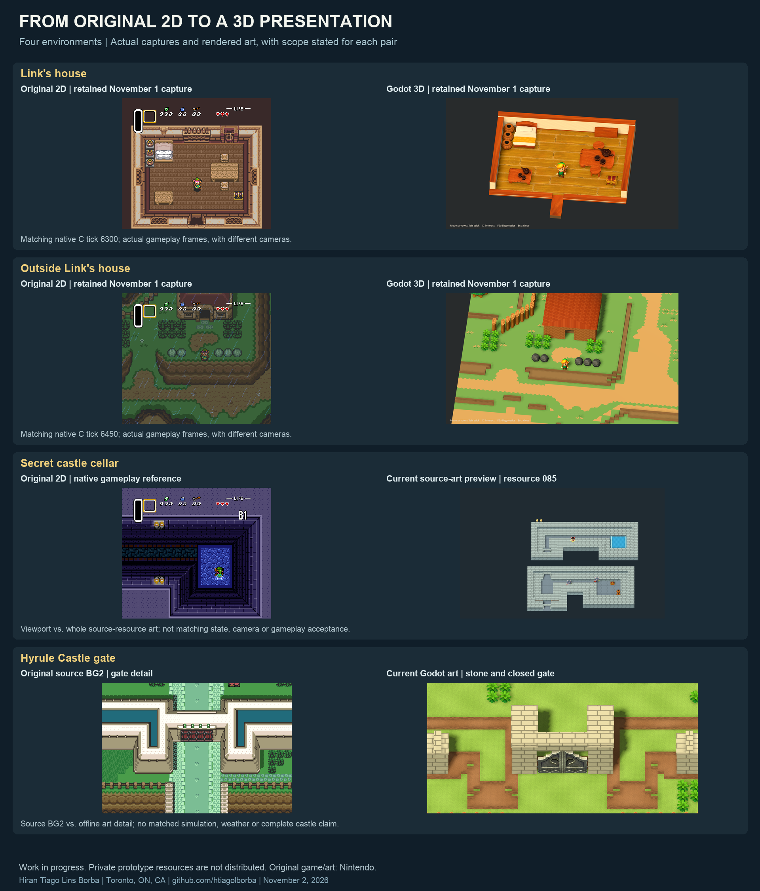
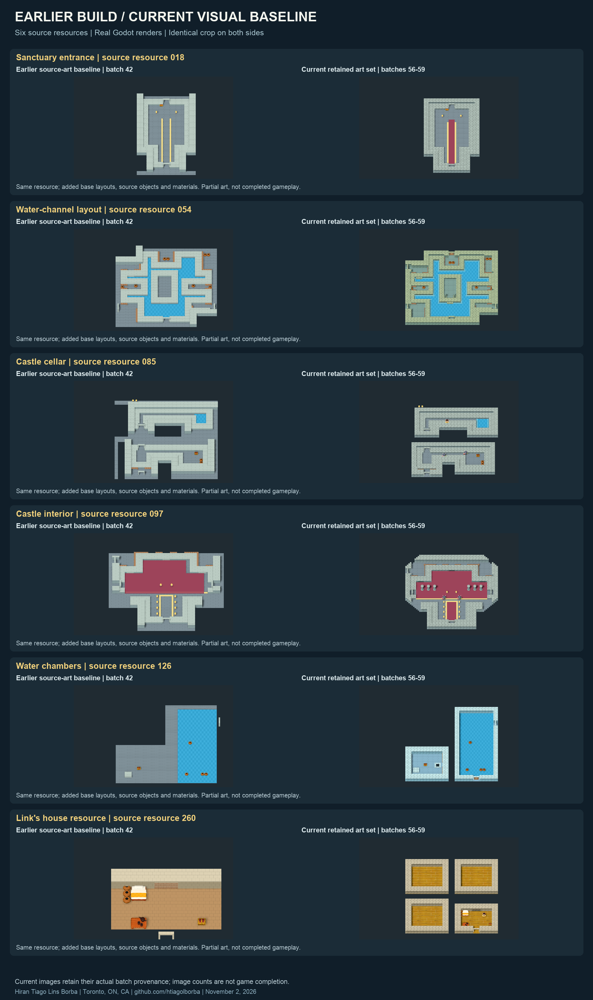
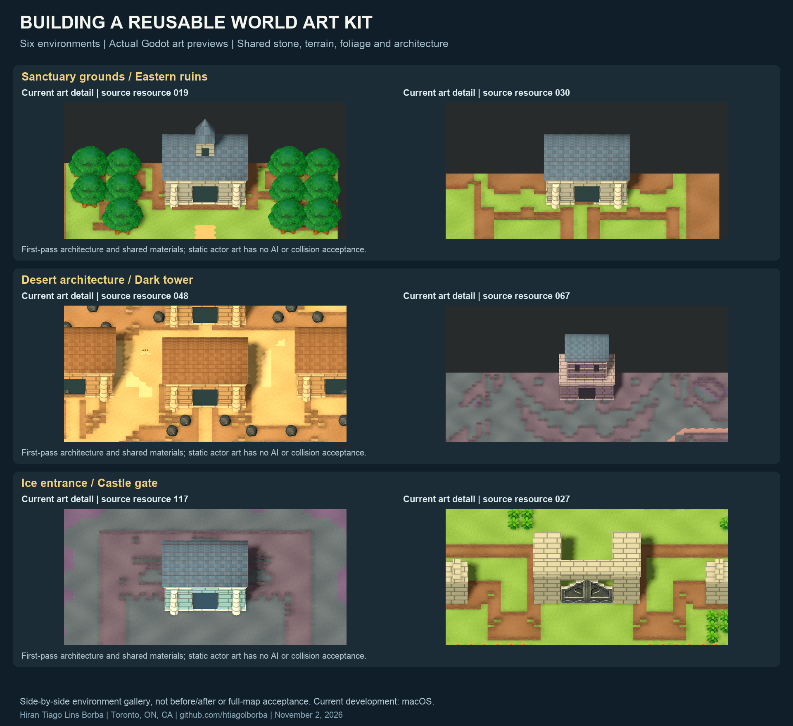

# Visual production progress — November 2, 2026

By **Hiran Tiago Lins Borba** · Toronto, ON, Canada · [GitHub](https://github.com/htiagolborba)

I am rebuilding the visual presentation of *A Link to the Past* as a miniature 3D world on macOS. Since the previous published checkpoint, I have shifted production toward reusable art families and source-driven batches, so one improvement can reach many environments. The existing reverse-engineered C implementation from [snesrev/zelda3](https://github.com/snesrev/zelda3) remains the gameplay foundation.

This is a private research milestone, not a downloadable 3D release. The public commit updates documentation and screenshots; it does not publish the private implementation or converted assets. Stable downloads retain the original 2D presentation.

## Original and redesigned environments

The opening-house and house-exterior pairs reuse the **November 1 actual gameplay captures**, at matching C ticks 6300 and 6450 respectively. They establish the playable presentation context; they are not new November 2 gameplay validation. Camera framing differs.

The cellar pairs an original gameplay viewport with the current **whole-resource art preview** for resource 085. The castle pairs a cropped native **BG2 source reference** with the current gate art detail. These pairs are not matched simulation states, full PPU composition or gameplay acceptance. All boards use real captured/rendered pixels, cropped and resized for documentation; no generated concept art is presented as gameplay.

[Castle comparison at full resolution](../images/2026-11-02/castle-comparison.png) · [Cellar comparison at full resolution](../images/2026-11-02/cellar-comparison.png)

## Earlier build versus current art baseline

These are the same six source resource IDs from the earlier batch-42 baseline and the retained batches-56–59 image set. Both sides use the same image crop. Added base layouts can expose multiple sublayouts in a resource; that is source inventory coverage, not multiple finished playable rooms. Wood, stone, carpets, source objects, water trim and room contours now provide a stronger production foundation.

## Exterior art gallery

This board shows six different environments side by side, rather than before/after pairs. Sanctuary, eastern ruins, desert architecture, dark tower, ice entrance and castle gate use shared terrain/materials and first-pass architecture. It is an offline art studio, without a C gameplay session. Source first-part actor placements are static visual previews.

## What the current numbers mean

| Production inventory | Current evidence | Interpretation |
| --- | --- | --- |
| Normal exterior resources | 80 decoded baselines | Partial source geography/art; not 80 completed maps |
| Special exterior resources | 2 separate previews | Resources 128/129; story/entrance variants remain unverified |
| Indoor resources | 320 baseline renders | Includes unused and default-only resources; not 320 finished rooms |
| Supported indoor descriptors | 19,972 | Includes repeated base-layout objects; not unique models |
| Indoor portal descriptors | 508 | Static ordinary/key/shutter archetypes; no door-state acceptance |
| Water/pit edge descriptors | 715 | Straight authored rims on supported source spans; conditional details pending |
| Indoor static actor placements | 286 across 87 resources | Visual placement only; no AI/combat/spawn acceptance |
| Exterior static actor placements | 147 first-part previews | Supported visual adapters; runtime behavior deferred |

The [changelog](../../CHANGELOG.md) contains the detailed implementation inventory, evidence and failures. These counts measure production coverage, not overall remake completion. The private weighted project estimate remains approximately **26%**, provisional and not increased simply by rendering more resources.

## How production became more efficient

I separated broad visual production from later gameplay acceptance. Source compilers feed shared architecture, materials and actor adapters into standalone art viewers. The viewers render content in batches; targeted checks catch import/render failures without repeatedly walking through the same gameplay sequence.

A fresh full indoor render established the material baseline. Later batches rendered changed resources and retained unchanged images only after exact room-JSON comparison, with explicit provenance. Cached images document their original render; they do not prove the newest renderer ran that scene.

Failed attempts stay in the private journal. Leever required a different animation clip; Armos is accepted only as static art; a detached model-cache cleanup and explicit material type were repaired before clean replacement renders. Uncertain source semantics remain visible instead of being silently guessed.

## Technology, authorship and remaining work

I lead the desktop adaptation, integration, art-production tooling and documentation with AI-assisted development. **C** provides the existing simulation; **GDScript/Godot** handles presentation; **Python** processes content and evidence; **shaders/materials** supply surface treatment. This is not Nintendo's Switch engine. Upstream reverse engineering belongs to the snesrev/zelda3 contributors; Nintendo retains the original game, characters and artwork. Private third-party visual resources remain excluded from the repository.

The current art studios do not replace the playable indoor renderer. Remaining work includes native BG layering and overlays, unsupported object families, source-specific architecture, story variants, dynamic actors, bosses, UI, performance and broader connected gameplay validation. The main pyramid is unfinished, and two wrapped ceiling-strip descriptors remain explicitly omitted. Current 3D production targets macOS; Windows work is deferred.

Next I will continue the visual families and architecture pass, then bind the expanded presentation to native state and validate longer playable routes. No stable release version changes with this checkpoint.

## Evidence and publication files

- [Image hashes, source hashes and crop provenance](../images/2026-11-02/manifest.json)
- [Sanitized milestone evidence summary](2026-11-02-evidence.json)
