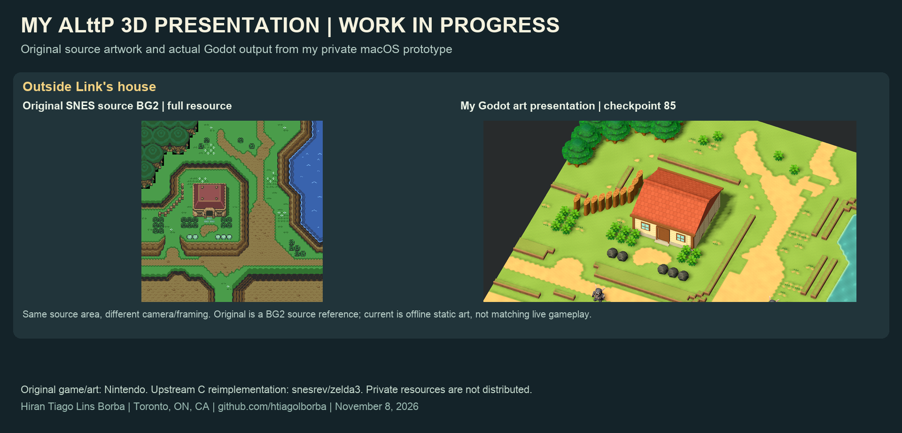
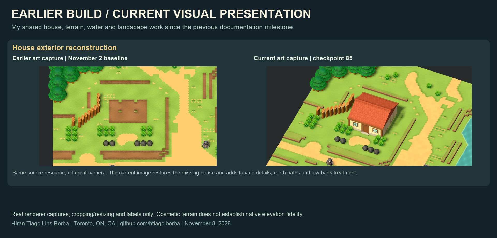
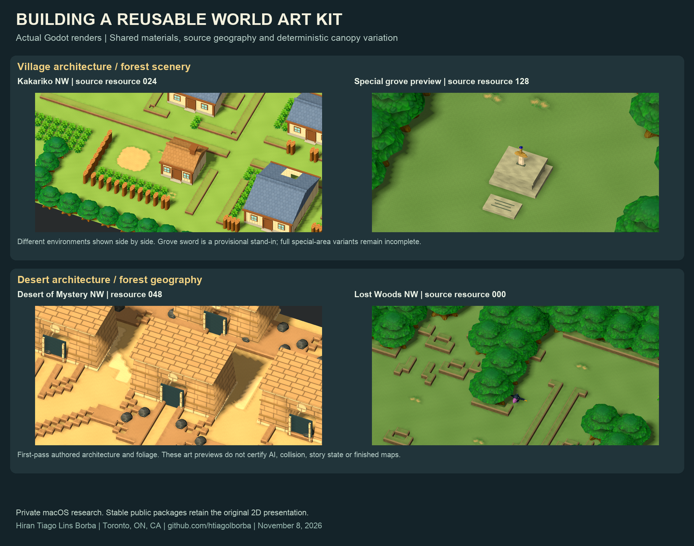
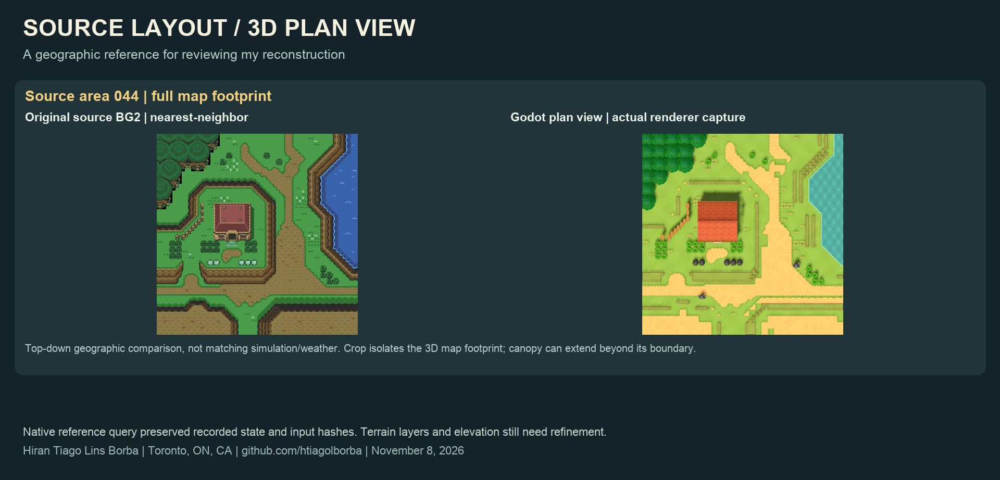

# Landscape kit, source comparisons and portable AI handoff

**Hiran Tiago Lins Borba · Toronto, ON, CA · November 8, 2026**

This documentation milestone consolidates private implementation through checkpoint 85, following the November 2 public update. Existing implementation receipts date from November 3. No new binary, Windows build or complete 3D game is released here.

## From source geography to a reusable presentation

I restored the missing house by correcting a JSON numeric comparison in the source-door predicate, then expanded the shared facade kit with foundations, timbers, door trim, eaves and roof detail. Source-mask earth paths now blend into turf; a shared masked water surface provides ripples and shoreline foam. Deterministic canopy variations preserve measured source root anchors. The art browser adds realm/region selection plus Focus and Overview.

*Same area with different framing. Left: native BG2 source reference; right: actual offline Godot render. This is not a matched live gameplay frame.*

*Earlier November 2 art capture versus candidate 85; camera differs. The missing-house correction and shared visual changes are implemented, but source-specific elevations and terrain families remain provisional.*

## Broader art production since the previous update

Work through checkpoint82 expanded source object/prop adapters, static indoor/outdoor actor art, wood/stone treatments, first-pass temple kits, special-grove canopy and original procedural hazard/actor meshes. Selected existing experimental models and original authored geometry remain private. Static art does not establish native animation or behavior.

*Actual Godot art previews, labeled by resource. Architecture is first-pass; the grove sword is a stand-in. These are not completed environments or a Switch-engine port.*

## Verification and honest scope

- Candidate84: all 82 exterior resource records freshly rendered, clean logged-error/PNG audit. Includes80 normal and two special shared resources.
- Candidate85: eleven mixed-size representative records passed the final landscape batch; measured tree root-anchor error was0.0. Browser UI rendering passed; manual dropdown interactions were not certified.
- Rejected landscape batch02 wrote eleven images but logged invalid indices caused by stale previous-region dimensions. Fresh room.width corrected the cause before the clean 03 batch. Failed receipts remain private evidence.
- Seven native source files were unchanged84→85. New low-bank geometry is offline art only and does not recover native physical elevation or change C collision/state.
- A prior native reference capture at tick6450 preserved the recorded snapshot/fingerprint and protected input hashes. A separate 3D plan-view camera enables a more direct geographic comparison.

*BG2 source versus 3D plan view. Weather, final PPU composition and simulation state are not matched. The 3D crop isolates the map footprint.*

Current indoor inventory:320 resource records including defaults/unused layouts;22,412 supported descriptors including repeats; partial adapters for 174/328 families;1,470 pending source entries and two wrapped ceiling omissions. Static previews include 863 indoor placements across175 records and 291 outdoor first-part placements. These are inventory measures, not finished scenes or whole-game percentages. See [sanitized evidence](2026-11-08-evidence.json) and [image provenance](../images/2026-11-08/manifest.json).

## Documentation and production reset

I consolidated current status, architecture/edit locations, known failures and next work into a short handoff usable by Claude or another coding assistant. Historical documents remain accessible but no longer compete as current instructions. An ignored local pointer connects the public checkout to the private workspace on my Mac without publishing its paths/resources.

Production now uses one agent and meaningful geographic/kit batches, with affected checks and a concise receipt. Actual images remain a quality gate: a successful render can still be visually wrong. No reliable whole-remake completion percentage has been established.

Next: source-specific terrain/elevation and coherent region silhouettes, layer/overlay fidelity, architecture refinement and special variants; then broader native-state presentation, animation/UI and end-to-end validation. Active 3D development targets macOS. The public stable game retains 2D graphics.

Project leadership and presentation/tooling work: Hiran Tiago Lins Borba, with AI assistance. Upstream reverse engineering: snesrev/zelda3. Original game/art: Nintendo. Private implementation/models/textures/game data remain excluded from this commit.
